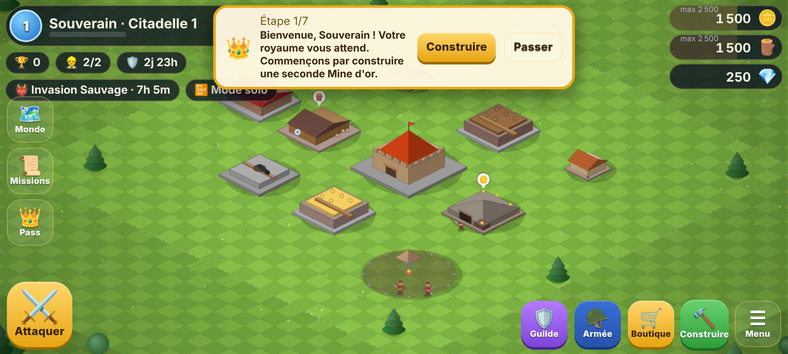
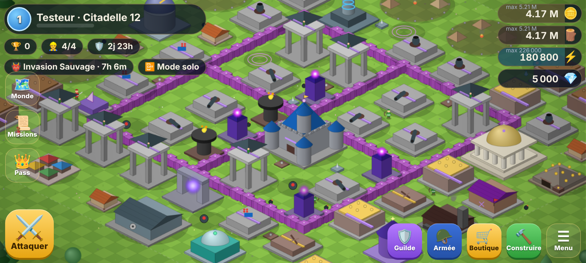
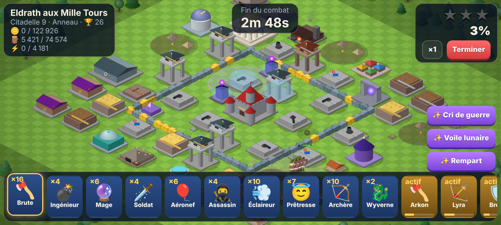
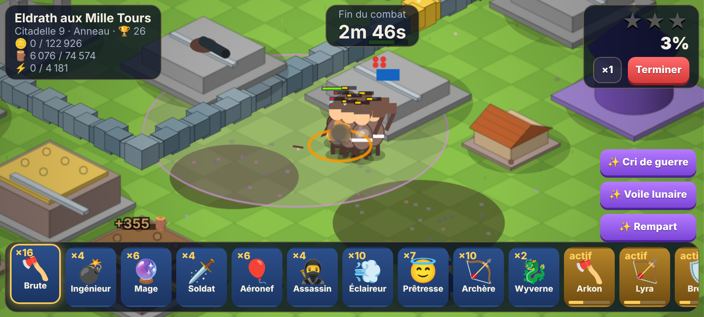

# 🏰 KINGDOMS

Jeu mobile de stratégie de villages — **construire, produire, améliorer, entraîner, attaquer, défendre, recommencer** — avec une identité originale (noms, personnages, bâtiments, cartes, sprites, musique et effets sonores tous créés pour le projet ; aucun asset externe).

| Village de départ | Citadelle 12 |
|---|---|
|  |  |
| **Raid** | **Héros en combat** |
|  |  |

## Télécharger / installer

| Fichier | Usage |
|---|---|
| [`dist/KINGDOMS-1.0.0-release.apk`](dist/KINGDOMS-1.0.0-release.apk) | Installation directe sur Android 6.0+ (signé v1+v2+v3) |
| [`dist/KINGDOMS-1.0.0-release.aab`](dist/KINGDOMS-1.0.0-release.aab) | Android App Bundle pour le Google Play Store (validé par bundletool) |

> ⚠️ Ces binaires sont signés avec une **clé d'upload générée localement pendant le build** (non versionnée). Pour publier sur le Play Store, reconstruisez avec **votre** clé (voir [docs/ANDROID.md](docs/ANDROID.md)).

## Contenu

- **Village** libre sur une carte isométrique 44×44 dont le territoire s'agrandit avec la Citadelle ; déplacement direct, **mode édition multi-sélection**, rotation, tracé de murs au doigt, sauvegarde automatique de la disposition.
- **Citadelle : 15 niveaux**, chacun débloquant bâtiments, unités, défenses, sorts, héros, décorations et zones (tableau complet : [docs/GAME_DESIGN.md](docs/GAME_DESIGN.md)).
- **4 ressources** : 🪙 Or, 🪵 Bois, ⚡ Énergie (avancée), 💎 Cristaux (premium). Mines, scieries, fermes, carrières, générateurs ; coffres, entrepôts, cellules, reliquaire ; marché.
- **50 types de bâtiments** : économie, militaire (caserne, camps 50→150, laboratoire, académie, atelier), défense (canon, tour de guet, mortier, lanceur céleste, flèche arcanique, baliste, brasier, tour tempête, murailles), **6 pièges cachés**, spécial (Citadelle, portail, temple, forge, observatoire), 14 décorations.
- **14 unités entraînables** + unité de saison + monstres d'invasion, chacune avec coût, temps, PV, dégâts, vitesse, portée et priorité de cible.
- **4 héros** (Arkon, Lyra, Bronn, Nyx) : niveaux, compétence, ultime chargé par les dégâts, équipement forgé, apparences.
- **7 sorts** (foudre, soin, rage, gel, bouclier, météore, téléportation) avec coût, recharge, animation et effets.
- **Combat** déterministe : IA d'unités (cible préférée, contourner ou percer les murs via champs de distance, combat contre défenseurs, soigneuses), IA défensive (portée, zone morte, priorités, rebonds, multi-cibles, montée en puissance), pièges cachés, héros défenseurs, troupes de guilde en défense.
- **Raids**, **campagne de 30 niveaux** (6 régions, chaque niveau introduit une mécanique, 7 formations), **carte du monde** à découvrir, **invasions** de monstres, **défenses hors-ligne** de votre vrai village avec bouclier et journal.
- **Recherche** : unités, sorts et arbre technologique en 5 branches (Militaire, Défense, Économie, Magie, Technologie).
- **Guildes** (création, adhésion, invitations, chat, dons de troupes et de ressources, niveaux) et **guerres de guildes** (préparation → attaques → défenses → score → victoire → récompenses).
- **Saisons**, **événements** tournants (Festival, Tempête, Invasion, Guerre Ancienne), missions quotidiennes et saisonnières, succès.
- **Boutique** (offres, packs, skins, décorations, ressources, pass), **Royal Pass** 30 paliers gratuit/premium, **achats intégrés** (`crystals_small`, `crystals_medium`, `crystals_large`, `starter_pack`, `season_pass`, `special_bundle`) avec validation, restauration, erreurs et achats déjà effectués. Cosmétiques sans avantage en combat.
- Profil, statistiques, collection, **classements** (mondial, régional, guilde, amis, saison), **tutoriel** en 7 étapes.
- **Audio procédural** (WebAudio) : musiques village et combat, sons de bâtiments, unités, attaques, victoire, défaite, récompenses.
- **Qualité BASSE / MOYENNE / HAUTE** (particules, ombres, météo, eau, résolution), météo, eau animée, végétation, éclairage jour/nuit.
- **Sauvegarde** versionnée avec somme de contrôle, copie de secours, **migrations** et réparation ; **progression hors-ligne** (« Pendant votre absence : 🪙 +12 450 Or… »).
- **Serveur autoritaire** : le client n'est jamais source de vérité en ligne (ressources, récompenses, résultats re-simulés, achats validés, classements).

## Démarrage rapide

```bash
npm install
npm run dev          # http://localhost:8080 (rechargement à chaud)
npm run build        # build/www (bundle unique, fonctionne aussi en file://)
npm test             # tests unitaires (jeu + serveur)
npm run test:long    # 600 combats, fuzzing économie 60 jours, sauvegardes corrompues, mémoire
npm run test:e2e     # parcours complet dans Chromium (viewport téléphone) + captures
npm run android      # build/www puis APK + AAB signés dans dist/
npm run server       # serveur autoritaire sur :8787
KINGDOMS_SERVER_URL=https://mon-serveur npm run build   # client connecté au serveur
```

## Documentation

- [docs/ARCHITECTURE.md](docs/ARCHITECTURE.md) — choix technologiques, organisation du code, simulation, rendu, performance.
- [docs/GAME_DESIGN.md](docs/GAME_DESIGN.md) — toutes les données de jeu (générées depuis le code).
- [docs/ANDROID.md](docs/ANDROID.md) — build APK/AAB, signature, intégration Google Play Billing.
- [docs/SERVER.md](docs/SERVER.md) — API du serveur autoritaire, anti-triche, déploiement.
- [docs/TESTS.md](docs/TESTS.md) — stratégie et résultats des tests.

## Limites connues (honnêtement)

- **Moteur** : Unity n'est pas installable dans l'environnement de développement utilisé (pas d'éditeur, pas de licence, téléchargements Google bloqués). Le jeu est donc écrit en **TypeScript + Canvas 2D** avec un moteur maison, empaqueté dans une application **Android native (Java + WebView)**. La simulation est indépendante du moteur et pourrait être portée.
- **Google Play Billing** : la bibliothèque n'est distribuée que via le dépôt Maven de Google, inaccessible ici. Le pont natif et le flux complet (validation serveur, restauration, erreurs) sont prêts ; tant que la bibliothèque n'est pas ajoutée, l'APK affiche « Boutique indisponible » (aucun achat simulé en release). Voir [docs/ANDROID.md](docs/ANDROID.md).
- **Tests sur appareil** : aucun émulateur Android n'a pu être installé. L'APK/AAB sont validés structurellement (aapt, apksigner, bundletool) et le runtime du jeu est testé dans Chromium avec les ponts Android simulés — pas sur un téléphone réel.
- **Multijoueur** : le serveur de référence (Node, stockage fichiers) est fourni et testé mais non déployé. Hors-ligne, les guildes sont peuplées de compagnons simulés et les classements sont simulés (clairement indiqué dans le jeu).
- **ARM64 / IL2CPP** : sans objet — l'application ne contient aucun code natif, l'APK est indépendant de l'ABI et s'exécute sur arm64.
